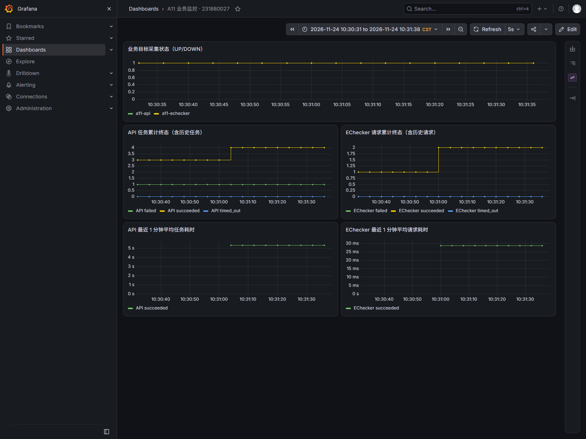
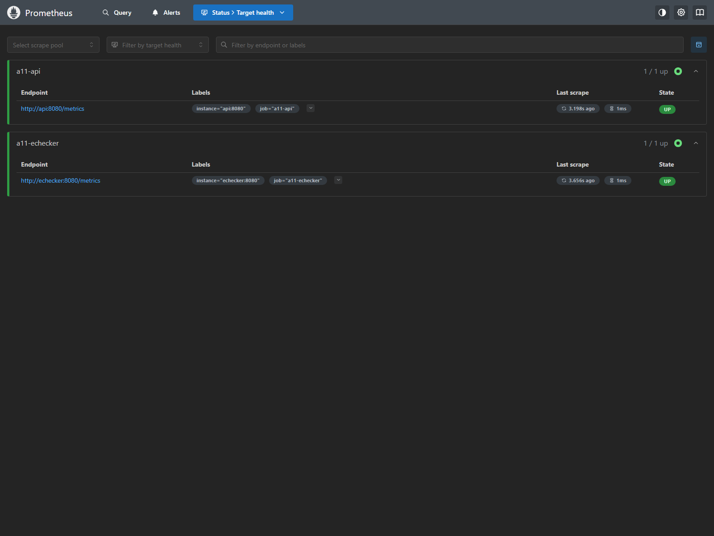

# Issue #53 阶段 2：A11 真实业务监控接入

- 负责人：@tongqianpolan（231880027），Refs #53。
- 日期：2026-11-24；显示时间统一 Asia/Shanghai，原始服务日志为 UTC。
- 分支：`feat/53-microservice-observability`；个人仓库：`/root/231880027/DevOps_A11-microservice`。
- 公共代码基准：`52877e89c0221396109a195dd9b1619babaa2715`（#52 / PR #55），个人配置未提交，逐文件 SHA 记录在 source.json。
- 本阶段：接入真实 API/EChecker 指标并执行一次个人正常任务。不包含 #54 正式停机与恢复采样。

## 部署配置

新增 [个人监控配置与启动说明](../../../../labs/observability/a11/README.md)，业务代码及公共 Compose 没有修改。监控项目为 `issue53-observability-231880027`，Prometheus 外接 `a11-microservice-241880439_default`，Grafana 走个人监控网络。端口仅绑定 `127.0.0.1:19391` 和 `127.0.0.1:13301`，通过电脑 SSH 转发访问。

| 对象 | 实际配置 |
| --- | --- |
| API 抓取 | a11-api → http://api:8080/metrics |
| EChecker 抓取 | a11-echecker → http://echecker:8080/metrics |
| 抓取周期 / 超时 | 4 秒 / 2 秒 |
| Grafana 数据源 | a11-prometheus → http://prometheus:9090，健康检查 OK |
| Grafana 面板 | a11-microservice-231880027，5 秒刷新，5 个业务面板 |
| 存储 | 个人持久卷；Prometheus 保留 14 天 |
| 镜像 | 与教师样例使用同一已核对 digest，配置固定于 .env.example；镜像 ID 见阶段 1 images.json |

## 个人正常任务

| Field | Value |
| --- | --- |
| job_id | `job-541dbec3a73d4df6814b1f6e68256457` |
| trace_id | `trace-cea16648836f46c096ff3b1d5a2d2cd8` |
| status | `SUCCEEDED` |
| request_key | `issue53-231880027-stage2-c8cc1b36afea4ed686d4cba43016268f` |

输入为公共 A11 配置探针，非教师固定依赖集合。完整 base 为 `5b431fcc656804434db59f4452f046ef284e6eb4`，target 为 `c2301112968b4cf185a94449e5dbc85764f4a2df`。请求原文和 SHA 已保存。

`run_job.py` 退出 0，同键重复提交返回同一 job/trace，五阶段顺序与提交关联正确，7 个公开产物完成 URI/字节数/SHA256 校验。修复前有 MISSING(helper.o, policy.h)，复验不再有 MD；REDUNDANT(main.o, unused.h) 仍存在，按当前检测配置如实保留，不声称 findings 全空。

指标前后 API succeeded 3→4、EChecker succeeded 1→2，各增加 1。API 既有 failed=1 属于采样前任务，本轮没有执行故障，不能把该历史值记作个人故障证据。API 与 EChecker 的计数是不同统计层级，不能相加作为业务任务数。

## 面板与实际 PromQL

- 业务目标采集状态（UP/DOWN）：`up{job=~"a11-api|a11-echecker"}`
- API 任务累计终态（含历史任务）：`a11_jobs_total{job="a11-api"}`
- EChecker 请求累计终态（含历史请求）：`a11_stage_requests_total{job="a11-echecker"}`
- API 最近 1 分钟平均任务耗时：`sum by (status) (rate(a11_jobs_duration_seconds_sum{job="a11-api"}[1m])) / (sum by (status) (rate(a11_jobs_duration_seconds_count{job="a11-api"}[1m])) > 0)`
- EChecker 最近 1 分钟平均请求耗时：`sum by (status) (rate(a11_stage_requests_duration_seconds_sum{job="a11-echecker"}[1m])) / (sum by (status) (rate(a11_stage_requests_duration_seconds_count{job="a11-echecker"}[1m])) > 0)`

计数器含历史，rate 可处理重启归零。低流量、窗口内没有已完成请求时，耗时显示空数据；不把空数据补成 0，也不声称具有 P95。原始 counter 的前后值与任务日志用于核对本轮增量。

本次截图窗口：2026-11-24 10:30:31 - 2026-11-24 10:31:38 (Asia/Shanghai)。所有面板查询均返回实际有限数据，两个业务目标在本阶段均保持 UP；本轮没有 DOWN。

截图为本机经 SSH 回环转发访问的真实页面，可作为正常监控画面的备份。正式期末三阶段画面仍待 #54 协调窗口后补齐；不将这张全 UP 图当作 UP/DOWN/UP 验收。

## 日志关联

同一个 job_id/trace_id 在 API 和 EChecker 中一致：

- API：job_started → draft → full-check → incremental-check → repair → recheck → job_finished。
- API 的 incremental-check 阶段 attempts=1、SUCCEEDED，耗时 30 ms。
- EChecker 的对应 role=echecker 日志状态 SUCCEEDED，elapsed_ms=29。
- API 整体 job_finished 为 SUCCEEDED，耗时 5323 ms。
- full-check 阶段实际调用两次，分别对应基线与目标全量对照，原始日志保留，不误记为两个业务任务。

公共五个业务容器的 ID、镜像、StartedAt、RestartCount、健康及网络在本次前后完全相同。个人仅部署监控、提交正常业务任务并只读采集日志，没有停止或重启公共业务容器。

## 验证与原始证据

服务器原始根目录：`/root/231880027/DevOps_A11-microservice/work/issue53-a11-stage2-20261124/`。

| 内容 | 原始相对路径 |
| --- | --- |
| 总结果、命令和时间 | result.json、commands.jsonl、window.json |
| 个人正常任务 | normal/request.json、submitted.json、repeated.json、status.json、manifest.json、check.json、downloads/ |
| 实际业务输入 | real-request.json |
| 前后原始业务指标 | before/after-api-metrics.txt、before/after-echecker-metrics.stdout |
| 抓取目标 | targets-before.json、targets-after.json |
| 5 个面板时序 | range-panel-1.json 至 range-panel-5.json |
| 面板导出及数据源 | grafana-dashboard-export.json、grafana-datasource.json、grafana-datasource-health.json |
| 同任务日志 | api-job.log、echecker-job.log；另存其他角色同任务日志 |
| 公共容器前后对照 | public-containers-before.json、public-containers-after.json |
| 配置来源与哈希 | source.json |
| 截图元数据 | capture.json、a11-grafana.png、a11-targets.png |
| 配置与差异校验 | post-verification.json |

已运行：个人 Compose config、Prometheus promtool、Grafana 数据源健康、5 个实际 PromQL 查询、正常任务客户端及日志关联断言；提交前差异/忽略规则见 post-verification.json。自动取证命令原文在 `work/run_issue53_a11_stage2.py`，控制台在 `work/issue53-a11-stage2-console.log`。原始 work/、.env 和浏览器登录目录不进入 Git。

AI 辅助及人工审阅状态见 [AI_USAGE.md](../../../../AI_USAGE.md) 中 2026-11-24 / #53 阶段 2 条目。尚未 commit/push。

## 下一阶段

与 #54 约定实际停机采样窗口，记录本轮正常/故障/恢复各 job/trace、错误码与同一窗口的 UP/DOWN/UP、业务计数和耗时，再补正式三阶段监控画面。当前阶段不得关闭 #53，也不把组长旧记录标作本人的独立故障实测。
