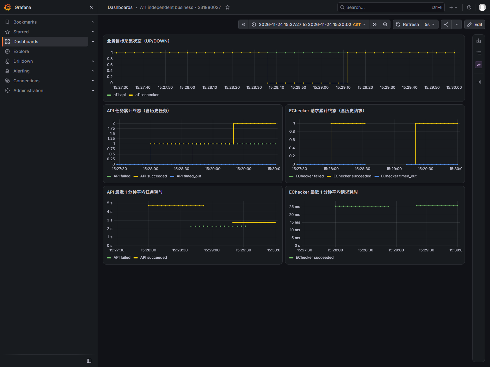
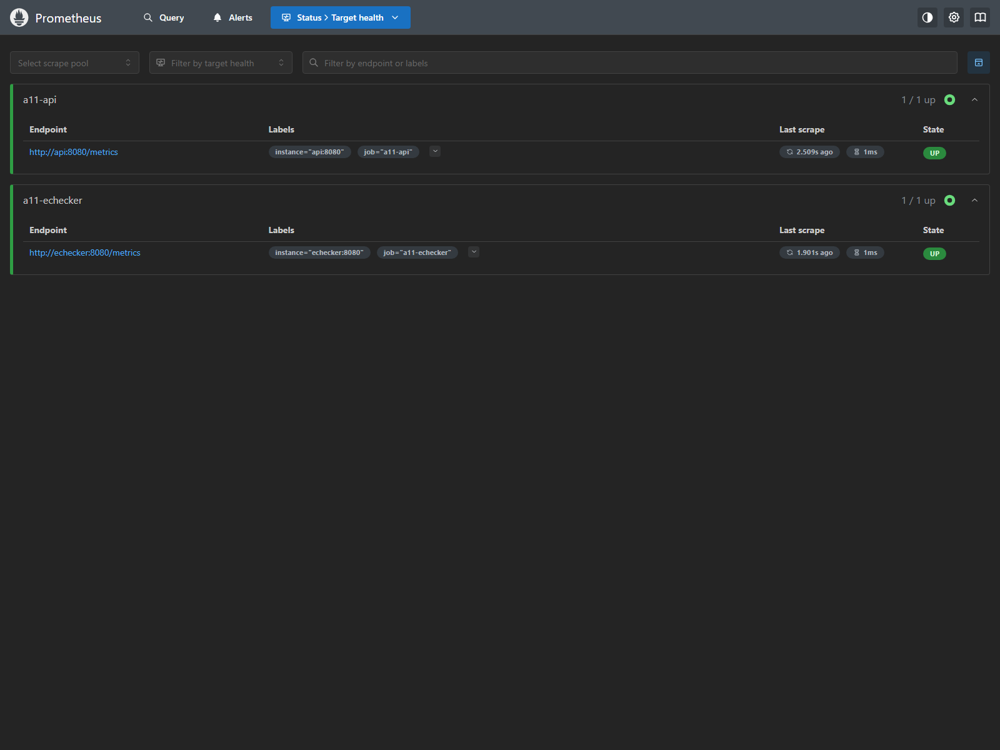

# Issue #53 阶段 3：独立业务正常、故障与恢复观测

- 负责人：@tongqianpolan（231880027），Refs #53。
- 日期：2026-11-24。图表和下表为 Asia/Shanghai；原始日志为 UTC。
- 分支：`feat/53-microservice-observability`。业务源码快照：`f4026115dfd4185fa26d178da396a604c3a0dbd1`。
- 范围：本人独立部署的 A11 真实业务栈，未停止公共服务，不将本轮当作 #54 的实测或公共协作窗口。
- [部署配置与完整重放说明](../../../../labs/observability/independent/README.md)。前两阶段记录分别为 [教师样例](sample-validation.md)、[公共业务正常监控接入](a11-observability.md)。

## 隔离与输入

Compose 项目为 `issue53-business-231880027`，网络为 `issue53-business-231880027_default`。仅个人 API/Prometheus/Grafana 绑定回环端口 18381/19392/13302，下游不暴露宿主端口。个人监控卷独立于教师样例及阶段 2 的公共网络监控。

运行根：`/root/231880027/DevOps_A11-microservice/work/issue53-independent-20261124/runtime`。它从已提交源码归档得到，不带旧 data/work 或真实登录配置。公共实现未改，新增的只是个人 Compose 监控 overlay、面板和说明。

使用公共 A11 项目的独立 bundle 克隆及候选原件：

- base：`5b431fcc656804434db59f4452f046ef284e6eb4`。
- target：`c2301112968b4cf185a94449e5dbc85764f4a2df`。
- bundle SHA256：`260d995d0d4721beb63303ff17e6e732ee6215d899b84660102d08afbd1e899c`。
- 候选 Dockerfile SHA256：`621c2d44a7f7b05a796f03ed6301b9df8d28e3aba9e7cac2520b2cd8f1def6a7`。
- 服务复用镜像 ID：`sha256:548752eeae6ae6ea598e0a5aa9e26874bb27c3065b22e554e800a6595b1e8d53`，不声称本轮重建服务镜像。
- 本轮请求仅把 repo/candidate 路径映射到个人 data/ 副本，三个场景的业务输入相同，幂等键不同。
- 私有项目 HEAD、工作区和所有非 .git 输入文件哈希在实验前后相同；公共 bundle/候选原件哈希也核对一致。

## 三阶段实际结果

| Scenario | Finished (Asia/Shanghai) | Job / trace | Status / error | Duration ms | Command exit |
| --- | --- | --- | --- | --- | --- |
| normal | 15:27:56 | job-7fc99430c18543f09df5905f4215a2bf / trace-56d326b60b9a429b991398b206bd6f75 | SUCCEEDED / None | 4737 | 0 |
| down | 15:28:38 | job-506772cafcad47158f56d20c1df2c46b / trace-60c40b88ce514a55bf637ba0edcc2719 | FAILED / DOWNSTREAM_UNAVAILABLE | 2296 | 0 |
| recovered | 15:29:17 | job-0c828b40be37442cb1d573286f20d079 / trace-7da8fceb434e46d5a437f76f5eae316e | SUCCEEDED / None | 2754 | 0 |

每条客户端命令均退出 0。故障场景退出 0 代表符合预期故障判定，任务本身仍为 FAILED。每场景同键重提使用相同 job/trace，三个场景之间 job/trace 各不相同；个人服务只建立了 3 个任务目录。

正常及恢复均完成 DRAFT→full-check→incremental-check→repair→recheck，分别校验 7 项公开产物的 URI、字节数和 SHA256。原有 MISSING(helper.o, policy.h) 被修复，REDUNDANT(main.o, unused.h) 仍保留，不写成 findings 全空。

## 同一窗口的真实监控

采样窗口：2026-11-24 15:27:27 - 2026-11-24 15:30:02。Prometheus 每 4 秒抓取，超时 2 秒；Grafana 每 5 秒刷新。

- 业务目标采集状态（UP/DOWN）: `up{job=~"a11-api|a11-echecker"}`
- API 任务累计终态（含历史任务）: `a11_jobs_total{job="a11-api"}`
- EChecker 请求累计终态（含历史请求）: `a11_stage_requests_total{job="a11-echecker"}`
- API 最近 1 分钟平均任务耗时: `sum by (status) (rate(a11_jobs_duration_seconds_sum{job="a11-api"}[1m])) / (sum by (status) (rate(a11_jobs_duration_seconds_count{job="a11-api"}[1m])) > 0)`
- EChecker 最近 1 分钟平均请求耗时: `sum by (status) (rate(a11_stage_requests_duration_seconds_sum{job="a11-echecker"}[1m])) / (sum by (status) (rate(a11_stage_requests_duration_seconds_count{job="a11-echecker"}[1m])) > 0)`
- EChecker counter resets: `resets(a11_stage_requests_total{job="a11-echecker",status="succeeded"}[5m])`

- API 在全窗口 up=1；个人 EChecker 有明确的 1→0→1。
- DOWN 对应本人明确停止的容器及其 status=exited 快照；不是仅凭单个抓取失败点判定停机。
- API 未重启，最终 succeeded=2、failed=1、timed_out=0。
- EChecker 在正常后 succeeded=1，停启后归零，恢复任务后重新为 1；resets 查询捕获至少一次重置，不能写作累计成功 2 次。
- 平均耗时按实际完成请求的 sum/count rate 比值计算，不补零。1 分钟滑动窗口可能继续显示停机前已完成请求的均值，不能据此认定停机期间仍有请求成功；是否可达以 up、容器状态和日志核对。

以上是经电脑 SSH 转发访问的真实页面。面板保留完整绝对时间范围和图例，可用作期末一页监控画面/备用截图。Targets 截图为恢复后的状态，故障 DOWN 的原始 Targets JSON 和时序另存；不把恢复后双 UP 截图当作故障时截图。

## 日志定位与恢复依据

正常任务与恢复任务分别在 API 和 EChecker 日志出现相同 job_id/trace_id，API 有阶段尝试、SUCCEEDED 阶段结束及唯一 job_finished，EChecker 有同任务 SUCCEEDED 结果。

故障任务在 API 的 incremental-check 阶段出现 3 次 stage_attempt_failed，错误码均为 DOWNSTREAM_UNAVAILABLE，最终 FAILED；实际错误消息为 `echecker: [Errno -3] Temporary failure in name resolution`。此时个人 EChecker 容器确实已停止，Docker 网络服务名无法到达；容器状态、up=0 与失败日志共同支持定位，不将独立网络环境故障冒充停机验收。

下游停止期间没有故障任务的 EChecker 日志，记录为未到达下游，不虚构服务端异常日志。人工启动同一 EChecker、健康恢复并取得 up=1 后，新任务成功且产物校验通过；这是人工恢复及新任务可用性验证，不声称自动恢复。

## 原始证据与追溯

原始根目录：`/root/231880027/DevOps_A11-microservice/work/issue53-independent-20261124/`。

| 内容 | 相对原始根路径 |
| --- | --- |
| 源码归档、输入、镜像来源 | prepare.json |
| 总结果、预期与场景 | evidence/result.json、expectations.json、scenarios.json |
| 真实命令、时间、退出码 | evidence/commands.jsonl |
| 三次请求、状态、公开产物 | evidence/{normal,down,recovered}/ |
| 同任务 API/下游日志 | evidence/{normal,down,recovered}-{api,echecker}-job.log |
| 完整角色日志 | evidence/logs-{api,buildchecker,echecker,draft,mdfixer}.stdout/.stderr |
| 正常/故障/恢复 Targets 与 counter | evidence/{initial,normal,down,restarted,recovered}-*.json |
| 停机与恢复时间 | evidence/stop-at.json、restore-at.json、down-sampled.json |
| 统一窗口与时序 | evidence/window.json、range-panel-*.json |
| 面板导出与数据源健康 | evidence/dashboard-export.json、datasource-health.json |
| 原输入前后状态 | evidence/input-before.json、input-after.json |
| 公共容器前后状态 | evidence/public-before.json、public-after.json |
| 个人服务最终状态 | evidence/private-after.json、compose-after.stdout |
| 配置逐文件 SHA | evidence/config-source.json |
| 截图与捕获信息 | evidence/independent-grafana.png、independent-targets.png、capture.json |
| 提交前校验 | evidence/post-verification.json |

取证脚本在个人仓库 `work/run_issue53_independent.py`，控制台为 `work/issue53-independent-console.log`。私有运行数据和服务产生的 trace、构建日志、报告及补丁位于各任务 `runtime/work/microservice-jobs/<job_id>/evidence/runtime/`，不进入 Git。

## 检查与协作边界

个人 Compose config、Prometheus promtool、数据源健康和六项实际时序查询（五个面板加重置查询）均通过。正常/恢复客户端及故障判定断言通过。输入副本前后完全相同，公共五个业务容器的 ID、镜像、StartedAt、RestartCount、健康、网络也完全相同。

原始 work/、.env、登录文件不提交；代码、配置、精选截图和索引可提交。AI 使用见 [AI_USAGE.md](../../../../AI_USAGE.md) 的 2026-11-24 / #53 独立业务条目。

本轮已完成个人三阶段观测，后续可供 #54 依此独立复测并确认协作要求；未执行其回滚验收、未联系或代签其结果。不能据此声称公共故障窗口已协同完成，整体 Issue 关闭由最终交付与组内评审决定。DRAFT 与下游镜像交接限制仍沿用公共实现：没有证明检测角色消费了 DRAFT 产出的镜像。ECS 资源和 Docker daemon/构建缓存仍共享，独立命名只隔离服务与数据，不代表完全资源隔离。
