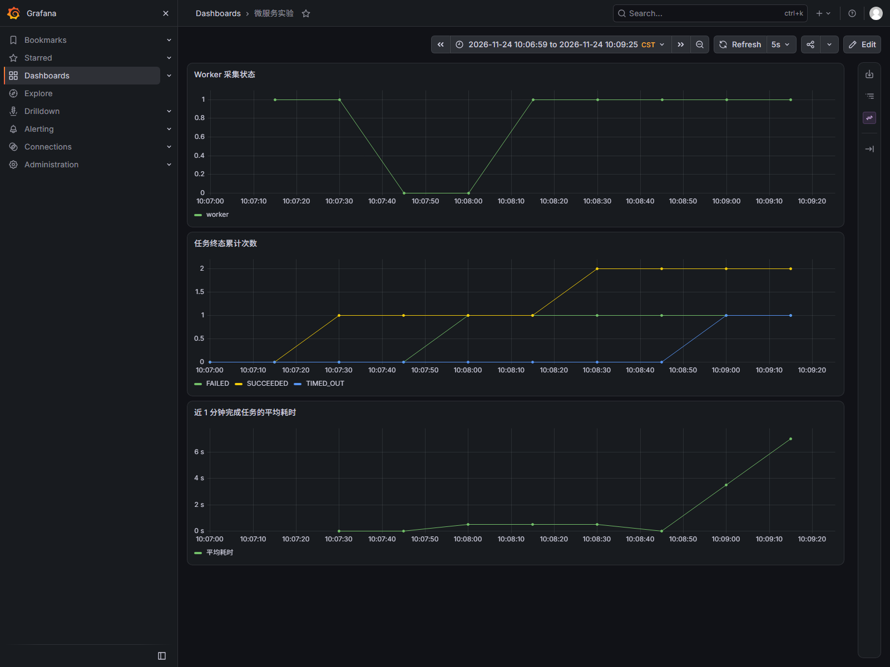
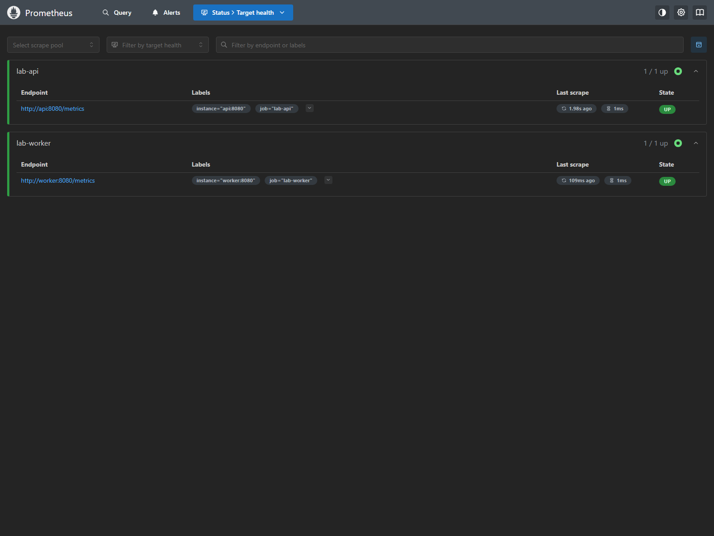

# Issue #53 阶段 1：教师样例独立观测

- 负责人：@tongqianpolan（231880027），Refs #53。
- 日期：2026-11-24。表中时间为 Asia/Shanghai；原始日志采用 UTC（+08:00 换算）。
- 范围：教师 API/Worker 样例；不计作 A11 真实项目监控验收。
- 分支：`feat/53-microservice-observability`。
- 公共基础：`52877e89c0221396109a195dd9b1619babaa2715`，来自未合并的公共 PR #55；公共合并后仍需同步。
- 个人工作目录：`/root/231880027/DevOps_A11-microservice`。
- 独立 Compose：`issue53-sample-231880027`，API/Prometheus/Grafana 回环端口为 18380/19390/13300。
- 配置和可重放操作：[教师样例目录](../../../../labs/observability/sample/README.md)。

## 配置与来源

选择性接入教师 Microservice_Lab 的 app/、scripts/、monitoring/ 和 compose.yaml，业务与监控配置保持教师原文。个人补充独立环境样例、操作说明、证据索引与实际观测。源文件 SHA256 见原始 source.json；镜像 ID 与仓库 digest 见 images.json，复放镜像引用写入 .env.example。

Prometheus 抓取 `api:8080/metrics`、`worker:8080/metrics`，job 为 lab-api、lab-worker；采样周期 4 秒，超时 2 秒。Grafana 数据源 UID 为 lab-prometheus，地址 `http://prometheus:9090`；面板 UID 为 microservice-lab，刷新周期 5 秒。

| 图表 | 实际 PromQL |
| --- | --- |
| Worker 采集 | `up{job="lab-worker"}` |
| 终态计数 | `lab_jobs_total` |
| 最近 1 分钟平均耗时 | `sum(rate(lab_job_duration_seconds_sum[1m])) / (sum(rate(lab_job_duration_seconds_count[1m])) > 0)` |

## 实测结果

| Scenario | Job / trace | Status / error | Attempts | Duration ms | Exit |
| --- | --- | --- | --- | --- | --- |
| normal | job-f8a1c14f59204c1fae81797d4f1df789 / trace-b481cf96ef5740139518843da702260c | SUCCEEDED / None | 1 | 13 | 0 |
| down | job-760b91d22b0348079705f2b51e53bea1 / trace-b528e0df6b6f42939bf22e476e1996cd | FAILED / DOWNSTREAM_UNAVAILABLE | 3 | 1003 | 0 |
| recovered | job-3faa8d158c474a4a9bd206466affa532 / trace-98bb9d8210ad4afe9b2824ff58ce8481 | SUCCEEDED / None | 1 | 3 | 0 |
| timeout | job-138bac78f87f4b83829dbd744624ff70 / trace-c70f8cb5ed93416d8e7f2ad399902490 | TIMED_OUT / DOWNSTREAM_TIMEOUT | 3 | 7006 | 0 |

四条验证命令均退出 0；down/timeout 的 PASS 表示预期故障被正确识别，任务终态分别仍为 FAILED/TIMED_OUT。正常与恢复报告 SHA256 匹配状态清单，内容均为 main.o 缺少 config.h、多声明 unused.h。每次新场景用新幂等键；同一场景重复提交的 job_id/trace_id 相同。

采样窗口：2026-11-24 10:06:59 - 2026-11-24 10:09:25（Asia/Shanghai）。Worker 有 1→0→1，API 全窗口为 1。累计业务任务最终为 SUCCEEDED=2、FAILED=1、TIMED_OUT=1；任务耗时以实际状态和指标为准，抓取成功不代表业务成功。

截图为通过电脑 SSH 回环转发取得的真实浏览器画面。Targets 截图为恢复后状态，故障期间 DOWN 由同窗口时序数据与面板证明。完整面板导出在原始证据 grafana-dashboard-export.json，配置版在教师样例 monitoring/grafana/ 下。

## 日志关联与错误定位

正常及恢复任务：API 的 job_queued、worker_call、job_finished 与 Worker 的 check_started/check_finished 使用相同 job_id/trace_id；各只有一次 job_finished。

停机任务：API 记录 3 次 worker_call、3 次 worker_error，错误码为 DOWNSTREAM_UNAVAILABLE，最终 FAILED。Worker 停止期间没有该任务下游日志，这是实际不可达结果。恢复后任务使用新的任务标识并成功，属于人工恢复。

超时任务：每次 Worker 休眠 3 秒，API 每次读取超时为 2 秒，最多 3 次尝试；最终 TIMED_OUT / DOWNSTREAM_TIMEOUT。它是教师样例的受控超时，与网络部署故障分开记录。

## 原始证据索引

相对个人仓库根目录：

| 证据 | 路径 |
| --- | --- |
| 总体验收、场景和采样窗口 | work/issue53-sample-20261124/result.json、scenarios.json、window.json |
| 命令、时间和退出码 | work/issue53-sample-20261124/commands.jsonl |
| 三阶段 Targets 与指标 | work/issue53-sample-20261124/{normal,down,recovered}-targets.json、range-*.json |
| 完整日志和逐任务日志 | work/issue53-sample-20261124/services.stdout、{normal,down,recovered,timeout}-job.log |
| 面板导出与数据源 | work/issue53-sample-20261124/grafana-dashboard-export.json、grafana-datasource.json |
| 镜像与代码来源 | work/issue53-sample-20261124/images.json、source.json |
| 截图与捕获元数据 | work/issue53-sample-20261124/sample-grafana.png、sample-targets.png、capture.json |
| 自动取证过程及原始故障 | work/issue53-sample-console.log、work/run_issue53_sample.py |

各场景 request/submitted/repeated/status/check/metrics/report 文件位于上表各场景的实际目录（下列路径相对教师样例 labs/observability/sample/）：

- normal: `work/normal-20261124T020720Z-49b58e`
- down: `work/down-20261124T020744Z-f01bfb`
- recovered: `work/recovered-20261124T020814Z-b4222f`
- timeout: `work/timeout-20261124T020839Z-eac47d`

## 部署问题与边界

Windows 上传导致 app/scripts/monitoring 目录为 0700，Grafana 起初未加载数据源和面板，API 导出返回 404。仅将个人样例目录改为 0755、普通配置改为 0644，.env 保持 0600，再重启个人 Grafana。重新核对数据源、面板、采样与日志通过；原始失败控制台保留。

原始 work/、.env、密码、浏览器登录目录不纳入 Git；只提交必要配置、记录和选定截图。个人 Compose 保持运行供查看，关闭命令见操作说明；公共服务未停机或重启。

本阶段不包含 A11 api/echecker 业务面板、#54 正式停机采样协作或最终期末监控画面，后续阶段继续完成，不关闭 #53。AI 使用记录见 [AI_USAGE.md](../../../../AI_USAGE.md) 的 2026-11-24 / #53 条目。
