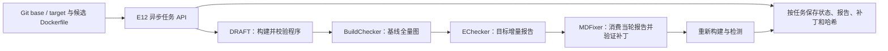

# A11 DevOps 期末项目报告底稿

- 项目名称：C/Make 依赖错误检测、修复与持续交付
- 小组：A11
- 成员：241880439 / MaxizYB、231880027 / tongqianpolan、241880411 / andelutixia
- 仓库：https://github.com/MaxizYB/DevOps_A11

正式封面使用三位成员本人确认的姓名。报告电子版建议 PDF，正文建议 6–10 页。下文以已核验记录为底稿，补齐组员证据与最终提交版本后定稿。

## 1. 背景、目标与完成范围

声明依赖描述了构建系统认定需要的输入。实际依赖来自一次真正的编译行为。两者不一致时，漏声明的头文件可能使增量构建忽略应该重编译的对象，多声明则可能触发多余构建。项目用受限的 C/Make 场景验证从构建、依赖对比到修复复验的工程链路。

已实现的范围包括固定输入/契约、镜像与可重放构建、全量和增量检测、报告校验、补丁与复验、任务 API、四角色部署、任务日志与业务指标。已用 A11 配置探针通过一次真实五阶段和受控停机恢复。成员负责的监控面板和正式独立重放见 #53、#54，组内结论以各任务的实际证据为准。

当前范围为既有教学 profile 和验证过的 cJSON profile。B11 的 E13 原始交互已归档，E14 的候选仍按待发布记录。下游角色继续用固定教学镜像，DRAFT 产物镜像用于构建和程序校验。

## 2. 系统设计与核心实现

API 用幂等键绑定请求，单工作线程串行接受任务。编排器在独立 Git 快照运行，经 Compose 网络用服务名调用四角色。提交 SHA、任务/跟踪 ID 和产物 SHA256 用于拒绝旧报告、跨任务产物和篡改内容。MDFixer 先在沙箱验证，应用、实际构建、运行、增量重建和复检过关后再更新该任务的目标快照。

## 3. DevOps 工程实践

| 环节 | 方法与解决的问题 | 证据入口 |
| --- | --- | --- |
| 版本管理与协作 | 以 Issue 划分可验收任务，分支、提交和 PR 都关联编号，并将评审与必需检查作为合并条件 | [A11 组协作规范](../A11组协作规范.md)、[#52](https://github.com/MaxizYB/DevOps_A11/issues/52)、[#53](https://github.com/MaxizYB/DevOps_A11/issues/53)、[#54](https://github.com/MaxizYB/DevOps_A11/issues/54) |
| 构建与依赖 | 镜像固定摘要、Python 依赖锁与工具链指纹，解决本机和服务器工具差异 | [E11/E12 入口](../e11-e12/README.md)、[课程镜像 Dockerfile](../../labs/e11e12/environment/services/buildchecker/Dockerfile) |
| 测试与质量 | 正常基线、依赖核验、错误补丁、旧报告、内容篡改、超时、重复请求和失败隔离 | [E7 门禁](../evidence/e7/README.md)、[E11/E12 验收](../e11-e12/最终验收与交付.md)、[E13/E14 证据](../evidence/e13-e14/) |
| CI 与交付 | Push/PR 触发契约、单测和实际构建；通过后发布可追溯的 Compose 配置和报告 | [E13/E14 工作流](../../.github/workflows/e13e14.yml)、[既有合并提交实跑](https://github.com/MaxizYB/DevOps_A11/actions/runs/44878532283)、[微服务复现](README.md) |

## 4. 代表性验收

选用 A11 配置探针。基线 `5b431fcc656804434db59f4452f046ef284e6eb4`，目标 `c2301112968b4cf185a94449e5dbc85764f4a2df`。预期正常程序输出 1，目标 `helper.o` 漏声明 `policy.h`，补丁后复检不再发现这条 MD。实际得到预期结果，`unused.h` 的 RD 仍如实保留。正常任务核验 174 项原始产物，另有目标项目本身的功能和组号边界测试。

停机时选择实际被调用的 EChecker。API 完成前序阶段后，在增量检测处记录三次服务不可达，约 2.08 秒进入失败终态。恢复后使用独立任务编号，再次生成由 SHA256 验证的报告和补丁。演示时在这段时间窗口展示业务面板及日志。

补丁拒绝用例造出能应用但使 Make 编译失败的补丁。验证拒绝，保留出错命令、原仓库 SHA/工作区和文件哈希对照。完整入口见 [组长验收记录](组长验收记录.md)。

## 5. 真实问题与工程取舍

1. **同一项目在不同 UID 上的 Git 快照处理。** 四角色运行时曾遇到 Git 对仓库属主的检查，由 [#46](https://github.com/MaxizYB/DevOps_A11/issues/46) 跟踪。修复只在经过路径约束的任务目录登记具体快照，并加入独立导入、边界和云端回归。保留每次任务的独立日志便于定位环境差异。
2. **cJSON 的构建和依赖形态超出最初双文件约束。** [#49](https://github.com/MaxizYB/DevOps_A11/issues/49) 记录了四服务不支持的问题。[PR #50](https://github.com/MaxizYB/DevOps_A11/pull/50) 为实际目标接入独立 profile，复用通用任务与产物边界，并在同一目标提交重跑。报告注明验证覆盖 `cJSON_Utils.o` 及实际 `make test` 的范围。

## 6. 三人分工和贡献入口

| 学号 | 历史贡献入口 | 本轮 |
| --- | --- | --- |
| 241880439 | 公共契约、集成和 E14 四角色，#42、#47、#50 | #52，公共接入及真实项目运行 |
| 231880027 | 基线与增量、报告关联独立核验，#45 / #51 | #53，监控、指标和日志 |
| 241880411 | API 边界、故障及哈希独立验收，#44 / #48 | #54，停机恢复、幂等与补丁回滚 |

各成员 PR、证据路径、AI 使用及实际个人贡献在定稿时补齐。AI 辅助使用见仓库 [AI_USAGE.md](../../AI_USAGE.md)。

## 7. 复现与汇报

[实验操作说明](README.md) 给出 Linux、Docker Compose、Python 3、Git 环境，真实输入及执行命令。现场先展示正常结果，再停止 EChecker，使用同请求的新键观察失败。恢复健康后提交新任务，展示补丁、重检结果、Grafana 和同一任务的日志。准备截图或录屏作为备用。

20 分钟建议分为项目与架构 4 分钟，协作、CI 和典型缺陷 5 分钟，运行与故障演示 8 分钟，以及贡献、限制与提问 3 分钟。由组长组织，成员分别准备自己负责的证据和问题。
